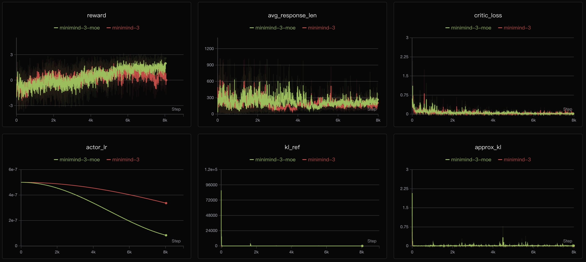
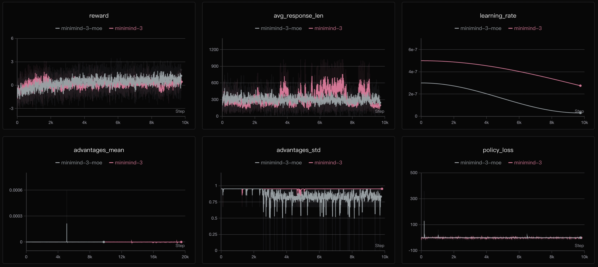
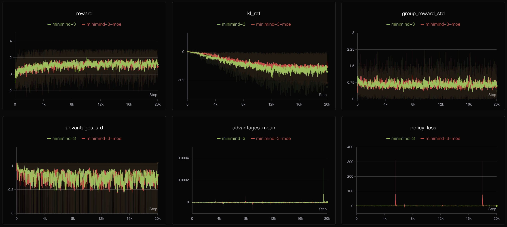
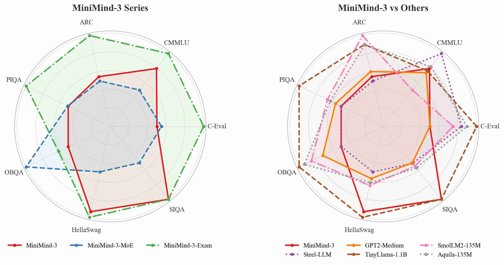

# 作者公开的结果：曲线与评测说明了什么

前三节的数字来自自行重训的 768 维 8 层权重。这一节收作者在 MiniMind 仓库 README 里公开的三批材料——RL 训练曲线、YaRN 的 PPL 实测、七项客观评测与四模型主观横评——把其中的数字逐个读成结论：哪条曲线说明了什么，哪个分数该按什么标准衡量，哪一处文字描述与图上读数并不一致。

图取自 upstream README（`jingyaogong/minimind`，2026-09 版），存于 [`images/upstream/`](../../images/upstream/)。

## RL 曲线：reward 缓慢上移，回答长度缩短

> 上图取自 MiniMind 官方 README；红 / 绿两条线分别是 Dense 与 MoE，六格依次为 reward、avg_response_len、critic_loss、actor_lr、kl_ref、approx_kl。

PPO 的六格里有三格值得看：

- **reward**：中心线从约 −2 升到约 +1，瞬时值在 −4 到 +3 之间波动。8k step 换来约 3 个点的中心线上移，噪声带宽远大于此。
- **`avg_response_len`**：红线的密集区间从约 500 降到 200 附近，MoE 一条波动更大，整体也在 300 以下。训练期的平均回答长度是下降的。
- **`critic_loss` 与 `kl_ref`**：前者起步时有一个约 3 的尖峰，随后压到 0 附近；后者起步时有一次约 `1e5` 的尖峰，之后归零。起步阶段的几个点不反映整条训练的状态。

> 六格依次为 reward、avg_response_len、learning_rate、advantages_mean、advantages_std、policy_loss。

GRPO 的形状相近：reward 带宽同样在 −3 到 +3 之间，中心线从 0 升到 1 附近；`avg_response_len` 在 300 上下大幅波动，红线中段有到 900 的尖峰，后段回落到 200 多；`policy_loss` 基本持平。

两张图里 **Dense 与 MoE 的曲线几乎重合**。0.1B 规模配 4 个专家，在 reward 上拉不开差距。这与 [02 节](02-server-training-records.md) 的独立训练一致（aux_loss 非零只说明路由在工作），也与 [03 节](03-eval-conclusions-sft-vs-rl.md) 的能力评测一致（MoE 并不比 Dense 更准确，推理反而更慢）。

> 六格依次为 reward、kl_ref、group_reward_std、advantages_std、advantages_mean、policy_loss；横轴到 20k step。

Agent RL 的横轴延伸到 20k step：reward 从 0 升到 1.5 附近，`kl_ref` 持续下漂至约 −2，`group_reward_std` 稳定在 0.7 上下。抬升幅度比 PPO / GRPO 明显，噪声带宽相当宽。

## 文字描述与曲线读数

README 对 GRPO 曲线的描述是「reward 呈现更加稳定的上升趋势，达到 4 左右」。对照上图，中心线在 0–1.5 之间，只有噪声带的上沿才偶尔触及 3–4。

图是逐步原始采样值，极差本就较大；文字里的「4」对应的是带宽上沿，即训练中偶见的高点。复述这条结论时，「中心线 0→1，瞬时带宽 −3 到 +3」更贴近图上可见的信息；写成「稳定收敛到 4」则是另一种含义。

自测中也有一组同形的数据：[02 节](02-server-training-records.md) 里 8 层 768 的 GRPO 独立训练，reward 末值约 0.70、区间 −3.0~2.7。两个规模、两套超参，结果都是噪声带宽较宽、中心线缓慢移动。在这一规模上，reward 曲线能支持的结论是训练在推进，尚不足以说明能力提升。

## YaRN：U 形变为单调下降

> 横轴为《西游记》白话文本的字符数，纵轴为困惑度；蓝线不开 scaling，橙线开 YaRN。

| 文本长度（字符） | 不开 scaling | 开 YaRN |
|---|---|---|
| ~700 | 11400 | 8700 |
| ~1500 | 4400 | 2900 |
| ~4500 | 3700（谷底） | 1300 |
| ~7500 | 5400 | 1100 |
| ~9500 | 7000 | 950 |

不开 scaling 的曲线呈 U 形：短文本处 PPL 在一万以上（上下文过短，可参考的历史有限，预测本就更难），到 4.5k 字符触底，之后**回升至 7000**。触底之后的这段上升即外推失效——位置越远，旋转角落入模型未见过的区间，预测精度持续下降。

开启 YaRN 后曲线单调下降，9.5k 字符处压到 950，末端已趋平。机制在附录 [RoPE 长度外推](../appendix/03-rope-length-extrapolation.md) 中已拆解：NTK-by-parts 让低频维度内插、高频维度保留，远端位置被拉回训练见过的旋转范围。这张图的形状正是该机制的直接结果。

横轴为字符数而非 token 数，PPL 又依赖 tokenizer，因此这组绝对值只在 MiniMind 自身的词表下成立；跨模型比较长文本能力，以 BPB 为准更稳妥。

## 客观评测：分数的解读需要参照标准误

作者用 lm-evaluation-harness 跑了 C-Eval、CMMLU、ARC-Easy、PIQA、OpenBookQA、HellaSwag、Social-IQa 七项：

| 模型 | 参数量 | C-Eval / CMMLU | ARC / PIQA / OBQA / HellaSwag / SIQA |
|---|---|---|---|
| minimind-3 | 64M | 24.89 / 25.38 | 28.49 / 50.65 / 23.60 / 28.28 / 34.19 |
| minimind-3-moe | 198M | 25.48 / 24.32 | 27.74 / 50.71 / 26.20 / 27.43 / 34.03 |
| minimind-3-exam | 64M | 30.98 / 26.12 | 35.61 / 56.26 / 24.20 / 28.40 / 34.19 |
| gpt2-medium | 360M | 23.18 / 25.00 | 43.60 / 66.38 / 30.20 / 39.38 / 39.10 |
| TinyLlama-1.1B | 1100M | 25.71 / 25.03 | 54.80 / 74.43 / 35.60 / 60.38 / 43.09 |
| SmolLM2-135M | 135M | 24.44 / 24.71 | 58.50 / 68.17 / 32.80 / 43.15 / 39.46 |
| Aquila-135M | 135M | 25.19 / 25.10 | 54.59 / 67.52 / 34.40 / 41.67 / 39.66 |

解读这张表需要一个尺度。按各数据集的样本量折算，单项标准误约为：OBQA ±1.9、C-Eval ±1.2、PIQA ±1.2、SIQA ±1.1、ARC ±0.9、HellaSwag ±0.5、CMMLU ±0.4；比较两个模型时，差值误差还需乘以 √2。以此为准，可以读出四条结论：

- **minimind-3 的 C-Eval 24.89、CMMLU 25.38 处于随机水平**（四选一为 25%），PIQA 50.65 也对应二选一的 50%。这一量级的知识容量使成绩停留在随机线附近，分数本身不宜读作「略低于随机」。
- **minimind-3 与 minimind-3-moe 相差 0.59，小于 ±1.2 的标准误**，两者无法区分。高低之分取决于本轮采样，而非结构差异。
- **minimind-3-exam 的提升超出误差范围**（C-Eval +6.09、ARC +7.12、PIQA +5.61），但其来源不在知识：做法是取 C-Eval / MMLU 的 test 子集抽样，加入前后缀格式增强，训一次轻量 LoRA 后合回基模。作者亦说明，对齐的是选择题的**输入格式**而非答案，七项平均提升约 2.9 点。
- **这一量级的分数与参数量并不对应**。gpt2-medium 有 360M 参数，C-Eval 为 23.18，低于 64M 的 minimind-3；而在英文任务上差距立现（ARC 43.60 对 28.49）。中文选择题考察的是词表与数据配比，不是参数规模。

> 左图三个 MiniMind-3 变体，右图是它与几个同量级模型的对照。

exam 一条接得上 [03 节](03-eval-conclusions-sft-vs-rl.md) 的核心结论：**SFT 类训练改变的是形式，不是事实**。形式对齐带来 3 到 7 个百分点的提升，改变不了自由问答中的事实正确性。作者另给出一个反向的例子：在有污染的 C-Eval / CMMLU 子集上直接微调，该模型可以跑到约 97%，这类分数没有参考价值。判断分数之前，先确认数据是否干净。

## 主观评测：总分与分项的错位

四模型、七道题（问答 ×5 + 代码 + 摘要），逐题由 GPT-5.4 按四项打分：

| 排名 | 模型 | 准确性 (30) | 完整性 (30) | 逻辑性 (20) | 代码 (20) | 总分 |
|---|---|---|---|---|---|---|
| 1 | minimind-3-moe | 11 | 23 | 16 | 18 | 68 |
| 2 | chatlm-mini-chinese (0.2B) | 25 | 19 | 15 | 3 | 62 |
| 3 | minimind-3 | 10 | 21 | 13 | 17 | 61 |
| 4 | baby-llama2-chinese (0.2B) | 8 | 6 | 5 | 2 | 21 |

第 1、3 名相差 7 分，优势却完全错位：MoE 版准确性 11/30（把长江说成珠穆朗玛峰、大熊猫吃海产品），代码 18/20；chatlm 准确性 25/30，代码 3/20（快速排序判断条件写反，函数无法使用）。前者长于表达与代码，后者长于事实。

总分将四项按权重相加，流畅度与代码能力可以补足准确性的缺口，于是表达更好的模型排在事实更准的模型之前。这张表更有效的读法是看分项、看错位，而非看总分排序：在有限参数预算下，小模型的表达与事实往往只能兼顾其一。

评审为 GPT-5.4 单模型、单轮采样、七道题，更换评审模型后排序可能变化，宜作体验参考而非榜单。

## 与自测结果的对照

| 观察 | 作者材料 | 本书自测 |
|---|---|---|
| RL 的 reward 不单调 | 中心线缓慢移动，带宽 −3~+3 | 8 层 768 独立训练，同为平噪声 |
| MoE 没有优势 | 曲线与 Dense 重合 | eval 无差异，decode 慢约 35% |
| YaRN 有效 | PPL 7000 → 950 | 未跑，单向引用 |

另有一处需要说明：作者曲线中训练期长度在缩短，而 [03 节](03-eval-conclusions-sft-vs-rl.md) 观察到 RL 输出变长。两者计量对象不同——训练期 `avg_response_len` 是数十步采样的均值，受 `max_len` 截断与 reward 塑形（长度惩罚或长度偏好）影响；03 节的长度是每条 prompt 单次采样后的输出长度。前者反映优化把分布推向何处，后者反映单次生成的长度，方向可以相反。

## 练习

1. PPO 曲线中 `avg_response_len` 下降，而固定 prompt 观察到 RL 输出变长，两者为什么能同时成立？
2. minimind-3 的 C-Eval 24.89 应如何解读？与 minimind-3-moe 的 25.48 相比，哪一个更好？
3. minimind-3-exam 提升 3 到 7 个点，为什么不能说明小模型的知识增加了？
4. gpt2-medium 的参数量是 minimind-3 的五倍以上，C-Eval 却更低，这说明中文选择题在考察什么？
5. 主观评测中总分第一的模型准确性只有 11/30，这张表应如何阅读？

参考答案

1. 训练期长度是数十步采样的均值，受 `max_len` 截断与 reward 塑形影响；固定 prompt 的观察是每条 prompt 单次采样后的文本长度。前者反映优化方向，后者反映单次生成，二者可以相反。
2. 四选一任务的随机基线为 25%，24.89 即随机水平，说明该量级的知识容量不足；与 MoE 的 25.48 相差 0.59，小于 ±1.2 的标准误，两者不可区分。
3. exam 是在 C-Eval / MMLU 的 test 子集抽样上加入格式增强做 LoRA，对齐的是选择题的输入格式（前缀、候选项组织），并未注入答案或知识；提升不会迁移到自由问答的事实正确性。
4. 考察的是词表与中文数据配比，而非参数量。gpt2-medium 的中文词表与中文语料都较弱，C-Eval 23.18 处于随机线附近；换到英文任务（ARC 43.60），它与 64M 模型的差距立即显现。
5. 看分项、看错位，而非看总分排序。总分把准确性（30 分）与完整性、逻辑性、代码相加，流畅度与代码能力可以覆盖准确性的缺口；第一名准确性 11/30、第二名 25/30，两者强项不同。

